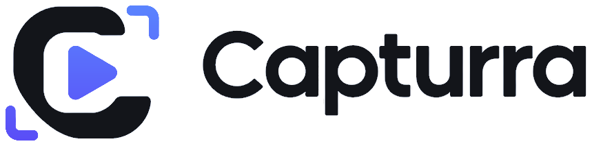
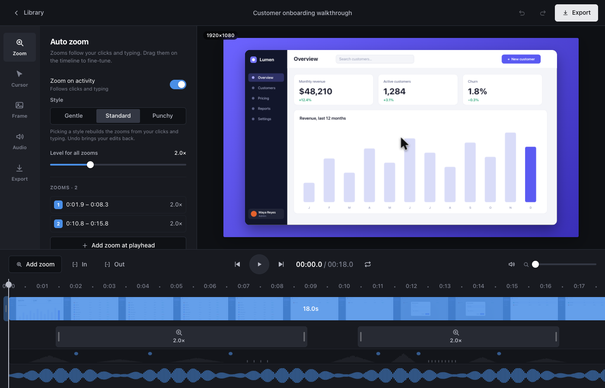
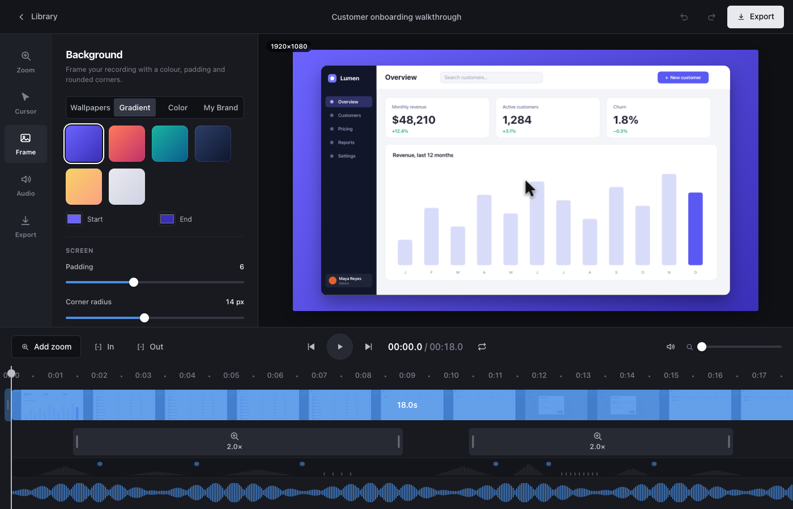

<p align="center">
  <picture>
    <source media="(prefers-color-scheme: dark)" srcset="apps/capturra-app/public/logo-white.png">
    
  </picture>
</p>

<p align="center">
  <strong>An open-source macOS screen recorder for product demos, tutorials and walkthroughs.</strong><br>
  It records your screen <em>without</em> the cursor, remembers what you did, and redraws a smooth cursor with auto-zoom afterwards.
</p>

<p align="center">
  <a href="LICENSE"></a>
  
  
  
  
</p>

<p align="center">
  
</p>

> Screenshots in this README show the built-in demo project (a made-up dashboard and a made-up waveform), not a real recording.

## Why

A raw screen recording looks like a raw screen recording: a jittery cursor, no focus, everything the same size.
The polish in a product demo comes from **data**, not pixels. Capturra records the screen with the cursor turned off
and logs the mouse and keyboard *timing* separately. The editor and exporter then use that data to:

- redraw a **smoothed cursor** with the real macOS cursor shapes, click ripples, and the pointing hand over buttons and links;
- **zoom automatically** to where you click and type, and follow the pointer so it never leaves the picture;
- put the recording on a **framed canvas** (wallpaper, gradient or colour, padding, rounded corners, shadow);
- clean up your **voice** and the sound, then export MP4 or GIF.

Nothing is baked in, so you can restyle the cursor, move a zoom or change the background after you have recorded.

## Features

| | |
|---|---|
| **Recording** | Display, window or region; 30 or 60 fps; system audio and microphone on one clock; countdown; global start/stop shortcut; Capturra's own windows are kept out of the video. |
| **Auto zoom** | Rapid clicks count as one, zooms merge instead of pumping in and out, the camera follows the pointer, and the zoom level fits what is on screen. Typing zooms to the **focused text field** (Accessibility API). Three styles: gentle, standard, punchy. |
| **Cursor** | Redrawn from recorded data with the real system cursor images (arrow, I-beam, hand...), adjustable size, smoothing, ripple and click squish, and a hand over clickable things. |
| **Studio editor** | Timeline with a real filmstrip, drag-to-edit zooms, trim, audio waveform, undo/redo, and a Frame tab with eight original wallpapers, gradients, flat colours and your own pictures. |
| **Audio** | Enhance voice (rumble, noise, level, clarity), volume, loudness, fades, mute. The preview and the export use the same filter chain. |
| **Export** | MP4 (x264 for the smallest file, or the Mac's hardware encoder for speed) and GIF. |
| **Privacy** | Everything stays on your Mac. Key presses store **timing only, never which key**. No network access, no telemetry, no accounts. |
| **CLI** | `capturra record / preview / zoom / synth / zoom-stats` for scripting and testing. |

<p align="center">
  
  
</p>

## Status

Capturra is **early**. It works end to end on the author's machine, but it has had very little testing elsewhere.

- Built and tested on **macOS 15 on an Intel MacBook Pro**. It has not been run on Apple Silicon or with several displays at once.
- It is **not signed or notarized yet**, so there is no download. You build it from source (see below). Signed releases are the next milestone.
- Some features are verified only by unit tests and short runs, not by hours of real use: the microphone, the Accessibility-based
  typing zoom and hover detection, system audio, and leaving Capturra's own windows out of display recordings. If something
  misbehaves, please open an issue.
- Share links and a GPU export path are not built.

## Build it

You need macOS 13 or newer, plus:

```bash
xcode-select --install                      # Xcode command line tools
brew install ffmpeg                         # needs libx264; h264_videotoolbox is optional (hardware export)
curl https://sh.rustup.rs -sSf | sh         # Rust
# Node 20.19+ for the app's interface (https://nodejs.org)
```

Run the app (a menu-bar icon appears; click it to record, right-click for the Studio):

```bash
cd apps/capturra-app
npm install
npm run tauri dev       # start it from Terminal: the permissions below belong to the app you launch it from
```

macOS asks for these in **System Settings > Privacy & Security**; grant them to the terminal app you start Capturra from,
then restart that terminal:

| Permission | Used for |
|---|---|
| Screen Recording | the picture (and system audio) |
| Accessibility | typing zoom (focused field) and the hand over clickable things |
| Input Monitoring | mouse and keyboard **timing** for the cursor and the zoom |
| Microphone | only if you turn the microphone on |

Build the command-line tool: `cargo build --release` puts `capturra` in `target/release/`.

### Try it without any permissions

The zoom and export pipeline works on any OS with ffmpeg, from a scripted recording:

```bash
./target/release/capturra synth --out demo
./target/release/capturra preview demo/recording.mp4 demo/events.json --out preview.mp4 --framed
```

### Record from the command line

```bash
./target/release/capturra record --out recording --seconds 15
./target/release/capturra record --list                              # displays and windows, with ids
./target/release/capturra record --region 100,100,1280,720 --audio --mic
./target/release/capturra preview recording/recording.mp4 recording/events.json
```

## How it works

```
crates/capturra-core      Event model, cursor smoothing, the auto-zoom engine. Pure Rust, no OS APIs, fully unit-tested.
crates/capturra-recorder  ScreenCaptureKit capture, input logging, cursor capture, focus and hover sampling,
                          audio, and the constant-rate ffmpeg encoder. All on one monotonic clock.
crates/capturra-render    The exporter: crop and zoom (Lanczos), cursor, framed canvas, audio, encode.
apps/capturra-cli         The `capturra` command.
apps/capturra-app         The Tauri v2 menu-bar app and the Studio editor (TypeScript + Vite, no framework).
vendor/                   Two small patched copies of third-party crates (scap, rdev); see their CAPTURRA-PATCH.md.
```

A recording is a folder: `recording.mp4` (no cursor), `events.json` (pointer, click and key **timing**, cursor images,
focus and hover), and `project.json` (your edits). The exporter replays them. The `events.json` format is versioned and
documented in [`crates/capturra-core/src/events.rs`](crates/capturra-core/src/events.rs).

## Develop

```bash
cargo test --workspace          # ~290 tests
cargo fmt --all -- --check && cargo clippy --workspace --all-targets
cd apps/capturra-app && npm run build      # type-checks and builds the interface
```

A few recorder tests record the real display on a timer and need Screen Recording permission and a quiet Mac; they can
fail on a busy machine without any code change. Read [`CONTRIBUTING.md`](CONTRIBUTING.md)
before opening a pull request.

## Roadmap

- [x] Recording, auto-zoom, cursor, Studio editor, audio, export
- [ ] Signed and notarized builds (Developer ID, hardened runtime, entitlements)
- [ ] Live outline of the recorded region while recording
- [ ] Apple Silicon and multi-display verification
- [ ] Share links (upload during recording, viewer page)
- [ ] GPU export path

## Acknowledgements

Capturra stands on [ScreenCaptureKit](https://developer.apple.com/documentation/screencapturekit), [Tauri](https://tauri.app),
[FFmpeg](https://ffmpeg.org), [`scap`](https://github.com/helmerapp/scap) and [`rdev`](https://github.com/Narsil/rdev)
(both vendored with small patches, under their MIT licenses). The idea follows tools like Screen Studio and Cap; Capturra is
an independent project and is not affiliated with them.

## License

[MIT](LICENSE)
